# Prison Management System (PMS)
## System Manual

| | |
|---|---|
| **Document** | PMS System Manual |
| **Version** | 1.0 |
| **Date** | 7 November 2026 |
| **Audience** | Station officers (Reception, Health, Administration), system administrators, supervisors and auditors |
| **Screenshots** | Taken from the live system at Chivhu Prison, signed in as Reception Officer *Anesu Doe* (1234567E). Inmate records shown are test records. |

---

### Contents

1. [System Architecture](#1-system-architecture)
2. [Account Creation and Roles](#2-account-creation-and-roles)
3. [Inmate Registration](#3-inmate-registration)
4. [Offence Registration and Sentencing](#4-offence-registration-and-sentencing)
5. [Reclassification](#5-reclassification)
6. [Messaging](#6-messaging)
7. [Report Building](#7-report-building)
8. [Custody: Station Configuration, Lockup and Unlock](#8-custody-station-configuration-lockup-and-unlock)
9. [Health](#9-health)
10. [Administration Account](#10-administration-account)
11. [Other Features](#11-other-features)
12. [Appendix A: Status Reference](#appendix-a-status-reference)
13. [Appendix B: Known Issues](#appendix-b-known-issues)

---

## 1. System Architecture

### 1.1 Overview

PMS is a web application. Officers use it in a browser; there is nothing to install on their computers. It has three layers:

```
 ┌──────────────────────────────┐
 │  Browser (React front end)    │  Screens, forms, validation, reports
 └──────────────┬───────────────┘
                │  HTTPS + JSON (REST API), signed-in token on every request
 ┌──────────────▼───────────────┐
 │  Application server (Django)  │  Business rules, access control,
 │  Django REST Framework        │  sentence calculation, audit trail
 └──────────────┬───────────────┘
                │  SQL
 ┌──────────────▼───────────────┐
 │  Relational database          │  One database for all stations
 └──────────────────────────────┘
```

| Layer | Technology | Responsibility |
|---|---|---|
| Front end | React, TypeScript, Vite, Tailwind CSS, shadcn/ui | All screens. Checks forms before they are sent, but never decides what a user may see. |
| Back end | Python, Django, Django REST Framework | Every rule that matters: who may see or change what, sentence and remission calculation, classification, approval workflows, audit logging. |
| Database | Relational (SQL) | Inmates, offences, sentences, health records, custody counts, messages, accounts and audit logs. |

### 1.2 Organisation structure

Every record and every account belongs to a point in the organisation tree:

```
National Headquarters (NHQ)
 └── Provincial Headquarters (e.g. Masvingo)
      └── Station (e.g. Chivhu Prison)
           └── Departments: Reception, Health, Administration, Stores, Security, Rehabilitation, Farms, IT
```

- An officer's account is assigned a **role** at a **unit** (station, province or NHQ) in a **department**.
- An officer sees records for their own unit and the units below it. A station officer sees only their station. A provincial officer sees all stations in the province. NHQ sees the whole country.
- This scoping is enforced on the server for every request, so changing a web address in the browser cannot reveal another station's data.

### 1.3 Back-end modules

| Module | Covers |
|---|---|
| `Auth` | Accounts, roles, capabilities, organisation units, sessions, admin console, audit log |
| `HumanResources` | The officer database (service records and postings) |
| `Reception` | Inmates, offences, sentences, court sessions, confirmations, classification, discharges, custody (yards, cells, lockup, unlock) |
| `Health` | Patients, admission and discharge assessments, OPD, mental health, chronic patients, medicines and equipment |
| `Messaging` | Department mailboxes, threads and messages |
| `Reports` | Report catalogue, report engine and exports |

### 1.4 Security principles

- **Sign-in:** service number and password. New accounts get a one-time password that must be changed at first sign-in.
- **Capabilities:** each role has a list of capabilities such as `reception.create` or `health.view`. Every screen and API call checks them.
- **Scope:** every list is filtered to the officer's unit and the units below it.
- **Audit trail:** registrations, sentence changes, confirmations, court outcomes, approvals and discharges are recorded with who did it and when. Audit entries are never edited.
- **Separation of duties:** Reception registers, Health assesses, Administration approves. No one officer can admit or discharge an inmate alone.

---

## 2. Account Creation and Roles

### 2.1 Who creates accounts

Accounts are created by **system administrators** (IT department) in the **Admin Console** (`/hq`). There are three tiers, each limited to its own area:

| Admin role | Held at | Can create accounts for |
|---|---|---|
| HQ System Admin | National HQ | Anyone in the country. Also manages the system-wide list of roles and departments. |
| Provincial System Admin | Provincial HQ (max 2 per province) | Officers in that province and its stations |
| Station System Admin | Station (max 2 per station) | Officers at that station |

System administrators manage accounts and structure only. They cannot see inmate or health records.

### 2.2 Creating an account, step by step

1. Sign in to the Admin Console and open **User Accounts**, then **New account**.
2. Choose the officer:
   - **Existing officer:** enter the service number of an officer already in the officer database for your area. Names come from the HR record.
   - **New officer:** enter the service number (7 digits and a letter, e.g. `1234567A`), names, national ID, gender, date of birth and date of attestation. The officer is added to the officer database and posted to the unit.
3. Choose the **unit** (station, province or NHQ), the **role** and, where the role does not fix it, the **department**.
4. Optionally enter the officer's **email address**. It is shown at the bottom of the sidebar and in the profile menu.
5. Click **Create**. The system shows a **one-time password** once, e.g. `Kq7m-Tx4p-Wz9r`.
6. Give the password to the officer **in person**. At first sign-in they must choose their own password.

Rules the system enforces:
- The username is always the officer's service number.
- One officer, one account.
- An officer must be posted to your area before you can give them an account.
- You can only grant roles you are allowed to grant, at units inside your area.
- Every account creation is written to the audit log.

> **Screenshot pending:** Admin Console account creation. To be captured with a system administrator account.

### 2.3 Roles and what they can do

| Role | Department | What the officer does in PMS |
|---|---|---|
| **Reception Officer** | Reception | Registers inmates (new admissions and transfers), records offences, sentences, bail, fines and restitution, records court outcomes and confirmations of sentence, proposes discharges, records lockup and unlock counts, configures yards and cells, builds reception reports. |
| **Health Officer** | Health | Admission and discharge health assessments, OPD visits, mental health visits, chronic patients, medicine stock and equipment, health reports. |
| **Administration Officer** | Administration | Approves admissions and discharges, approves classifications, views every operational module at the station, manages cases. |
| **Stores Officer** | Stores | Stores module. |
| **Security Officer** | Security | Security module. |
| **Rehabilitation Officer** | Rehabilitation | Rehabilitation module. |
| **Farms Officer** | Farms | Farms module. |
| **Auditor** | – | Read-only access to every module in their area, including reports and export. |
| **HQ / Provincial / Station System Admin** | IT | Accounts, roles, departments, organisation units, sessions and the audit log. No operational data. |

Administrators can add their own roles alongside the built-in ones. Built-in roles cannot be deleted or renamed.

### 2.4 Signing in and the account card

After sign-in, the officer's name and mailbox appear at the bottom of the sidebar, and their name and role in the top-right profile menu.

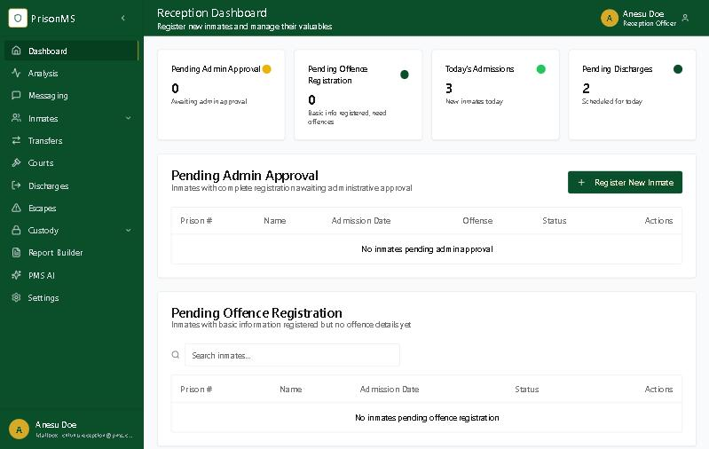
*Figure 2.1: Reception dashboard. The sidebar lists the modules the role allows; the account card shows the officer and the department mailbox.*

---

## 3. Inmate Registration

Inmate registration is done by a **Reception Officer** from **Inmates → New Admission**. The form has five sections. Fields marked with a red asterisk are required. The form checks each section before it lets you move on.

### 3.1 New inmate admission

**Section 1: Prison details**

| Field | Notes |
|---|---|
| Admission Type | **New Admission** for a person entering custody for the first time on this committal. |
| Prison Number | Station sequence and year, e.g. `0008/26`. Must be unique. |
| CRB Number | Police Criminal Record Book number. Optional. |
| First-time offender | Ticked by default. Untick if the inmate has a previous conviction. |
| Admission date | The date the inmate arrived. |

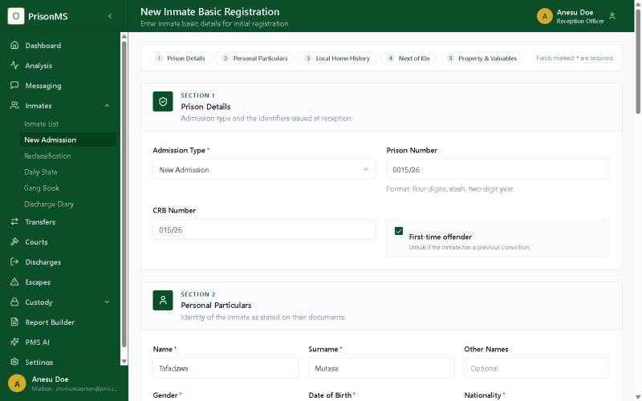
*Figure 3.1: Section 1, prison details. A Reception Officer is admitting a new inmate.*

**Section 2: Personal details and local home history**

Name, surname, other names, gender, date of birth, national ID, nationality, marital status, religion, education, occupation and physical description. Under **Local Home History**: chief, headman, village, district, province and **Father's Name**.

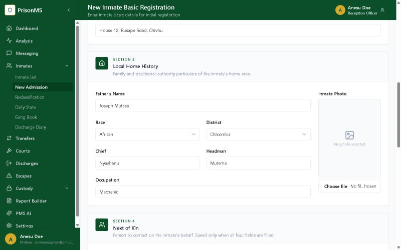
*Figure 3.2: Local home history, including Father's Name.*

**Section 3: Next of kin.** Name, relationship, phone and address.

**Section 4 and 5: Property and valuables.** Tick each item held (shoes, shirt, **trousers**, jacket, watch, phone and others) and describe it.

**Cash held** is recorded per currency. Click **Add currency** for each one. An inmate holding USD 10, ZWG 500 and ZAR 4,000 has three rows, each stored in its own currency. Supported: USD, ZWG, ZAR, BWP, GBP, EUR. The same currency cannot be entered twice.

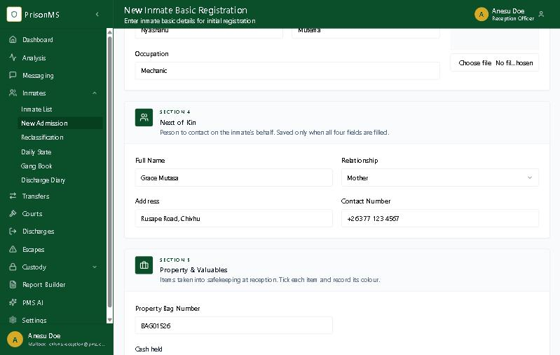
*Figure 3.3: Next of kin and property, with Trousers among the valuables.*

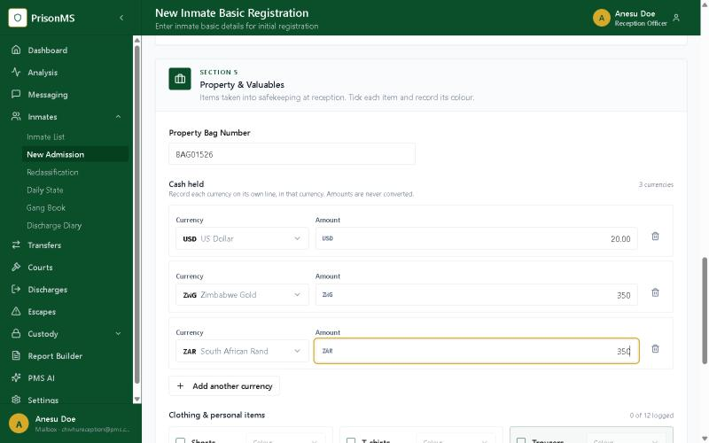
*Figure 3.4: Cash held in several currencies, one row per currency.*

Click **Save**. The inmate is created with:
- Status **Pending**, admission status **Pending Health Assessment**.
- An audit entry recording who registered the inmate.

You then go straight to offence registration (Section 4).

After admission, the details appear on the inmate's record:

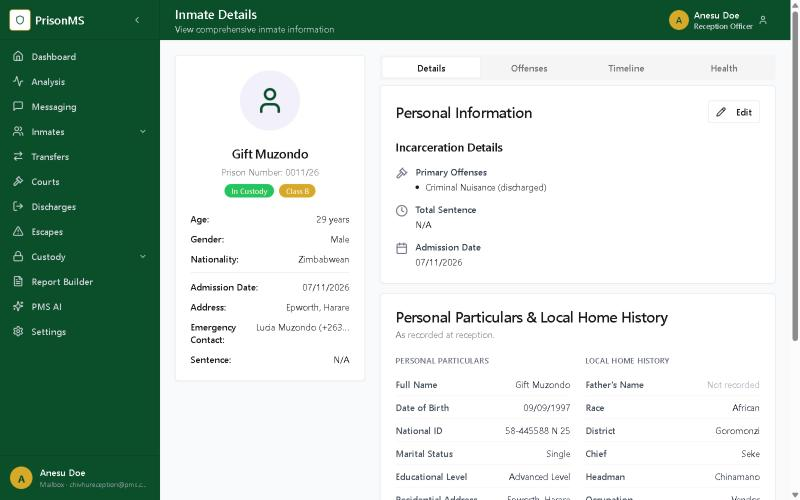
*Figure 3.5: Inmate details showing personal details, home history (with Father's Name) and property.*

### 3.2 Registering a transferred inmate

Use the same form with **Admission Type = Transfer**. Use this when an inmate arrives from another station.

1. Choose **Transfer** in Section 1.
2. Enter the prison number your station gives the inmate, and the original admission date from the transfer papers.
3. Complete personal details, next of kin and property from the transfer documents, checking property against the property list that came with the inmate.
4. Record the inmate's offences and sentences **exactly as on the committal and warrant**: the original sentence date, the original sentence and any concurrency. PMS recalculates remission and release dates from the original sentence date, so days already served are counted.
5. Save. The inmate goes through the same Health → Administration admission steps as a new admission.

> **Note:** The dedicated **Transfers** module (station-to-station transfer requests and handover) is not built yet and shows *Page Not Found*. Until it is, transfers are recorded as described above.

### 3.3 What happens next: the admission workflow

```
 Reception registers    Health officer does the    Administration officer
 inmate + offences  ──► admission assessment   ──► approves the admission
                                                    and the classification
 Pending Health          Pending Admin Approval      Admission Confirmed
 Assessment
```

The inmate stays **Pending** until Administration approves (Section 10).

---

## 4. Offence Registration and Sentencing

### 4.1 Recording offences

After registration, Reception records every offence (count) on the warrant. For each one:

| Field | Notes |
|---|---|
| Offence | Name of the offence, e.g. *House Breaking*. For several counts, name them *Count 1 – Robbery*, etc. |
| Court and case number | The court that dealt with the matter. |
| Status | **Unconvicted** (on remand) or **Convicted**. |
| Remand date / next court date | Unconvicted only. The next court date appears in the Courts calendar. |
| Date of sentence and sentence (years, months, days) | Convicted only. |
| Bail | Tick and enter the amount if bail was granted but not paid. |
| Fine | Tick and enter the amount if the sentence has a fine option. |
| Restitution | Amount, due date and the part of the sentence suspended on payment. |
| Concurrent with | Choose another count this one runs concurrently with. |

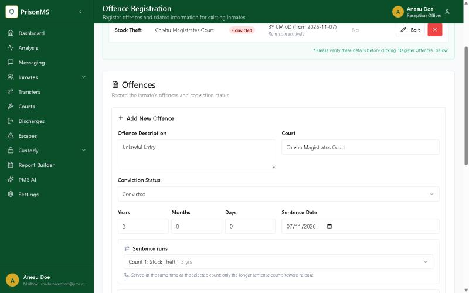
*Figure 4.1: Recording a count. "Concurrent with" links it to another count.*

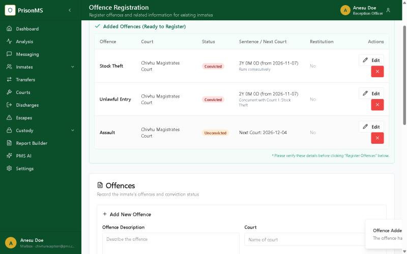
*Figure 4.2: The summary table lists every count before saving.*

Before saving, the **release preview** shows the dates the system will calculate:

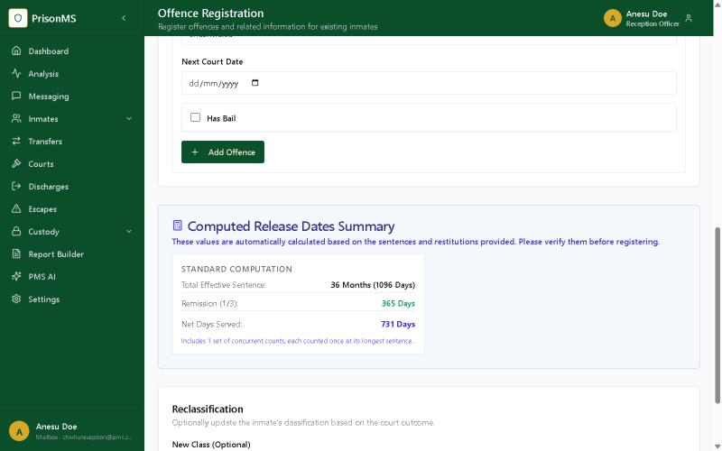
*Figure 4.3: Release preview: total sentence, remission, earliest date of release (EDR) and official date of release (ODR).*

### 4.2 How the sentence is calculated

PMS uses the rules below for every convicted inmate. They are applied on the server, so every screen and report agrees.

1. **Sentence length in days.** Months and years are counted on the calendar from the date of sentence. *12 months from 7 Nov 2026 is 365 days; 24 months is 731 days because it includes 29 February 2028.*
2. **The date of sentence is day one.**
3. **Remission** is one third of the sentence, rounded down: `remission = days ÷ 3` (whole days).
4. **Official Date of Release (ODR)** = date of sentence + days − 1.
5. **Earliest Date of Release (EDR)** = date of sentence + (days − remission) − 1.
6. **Concurrent counts** are served together and count once, at the longest sentence in the set.
7. **Consecutive counts** (and concurrent sets) are added one after the other, starting from the earliest date of sentence.

### 4.3 Classification

The class is calculated from the time left to serve and is proposed to Administration for approval:

| Situation | Class |
|---|---|
| Any offence still unconvicted (remand) | **D** |
| 84 months or more to serve | **D** |
| 36 to under 84 months | **C** |
| 18 to under 36 months | **B** |
| Under 18 months | **A** |

### 4.4 Worked scenarios

The scenarios below use the test inmates registered at Chivhu. Today's date in the examples is 7 November 2026.

#### Scenario 1: One unconvicted offence (remand)
**Farai Chirinda, 0008/26.** *Unlawful Possession of Property*, on remand.
- No sentence, no release dates. The inmate details show **Unconvicted** and the next court date.
- The next court date appears on the **Courts** calendar.
- Classification: **D** while on remand. *(In the test data the class was set manually to B at registration; Administration should correct it on approval.)*
- At the court date, Reception uses **Record Court Session** to enter the outcome (Section 4.6).

#### Scenario 2: One convicted offence
**Lovemore Zhou, 0009/26.** *House Breaking*, sentenced 7 Nov 2026 to 18 months. At confirmation the sentence was **reduced to 12 months** (Section 4.7).

| | Value |
|---|---|
| Sentence | 12 months = 365 days |
| Remission | 365 ÷ 3 = **121 days** |
| EDR | 7 Nov 2026 + (365 − 121) − 1 = **8 Jul 2027** |
| ODR | 7 Nov 2026 + 365 − 1 = **6 Nov 2027** |
| Class | Recorded as **C** at registration. After the reduction the calculated class is **A** (under 18 months), so the inmate is due for reclassification (Section 5). |


*Figure 4.4: Inmate details with sentence, EDR and ODR.*

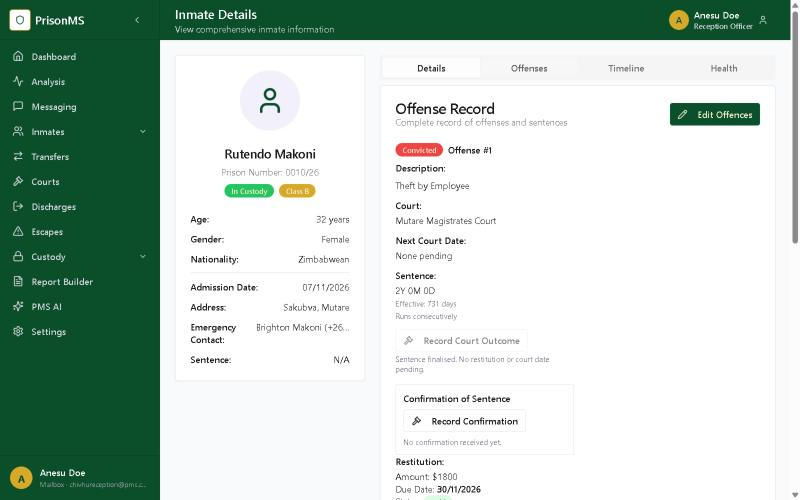
*Figure 4.5: An offence record.*

#### Scenario 3: More than one convicted offence, consecutive and concurrent
**Tinashe Moyo, 0013/26** (and Farai Ncube, 0014/26, the same pattern). Three counts sentenced 7 Nov 2026:

| Count | Sentence | Runs |
|---|---|---|
| 1 – Robbery | 36 months | concurrent with Count 2 |
| 2 – Unlawful Entry | 24 months | concurrent with Count 1 |
| 3 – Theft | 12 months | consecutive |

- Counts 1 and 2 run together and count as the longest: **36 months**.
- Count 3 follows: 36 + 12 = **48 months = 1,461 days**.
- Remission: 1,461 ÷ 3 = **487 days**.
- EDR: **7 Jul 2029**. ODR: **6 Nov 2030**.
- Class: 48 months → **C**.


*Figure 4.6: Counts 1 and 2 shown as one concurrent set; Count 3 added consecutively.*

#### Scenario 4: More than one unconvicted offence
Several counts on remand are each recorded as **Unconvicted** with their own court and next court date. The inmate is class **D**. Each count is dealt with on its own at court: some may be convicted, some discharged, and some remanded again. While any count is unconvicted the inmate stays class D and has no release dates.

#### Scenario 5: Mixed convicted and unconvicted, with restitution
**Rutendo Makoni, 0010/26.**

| Count | Status | Details |
|---|---|---|
| Theft by Employee | Convicted 7 Nov 2026 | 24 months, of which **4 months suspended on restitution of USD 1,800** |
| Fraud | **Unconvicted** | On remand, next court date set |

- Until restitution is paid, the full 24 months (731 days) applies.
- Restitution was paid in two receipts (USD 500 and USD 1,300). Once fully paid, the 4 months fall away: **20 months = 611 days**, remission 203 days.
- EDR **19 Dec 2027**, ODR **9 Jul 2028**.
- Because the Fraud count is unconvicted, the inmate still has a court matter and the calculated class is **D**. *(The test record shows B, set manually at registration.)*

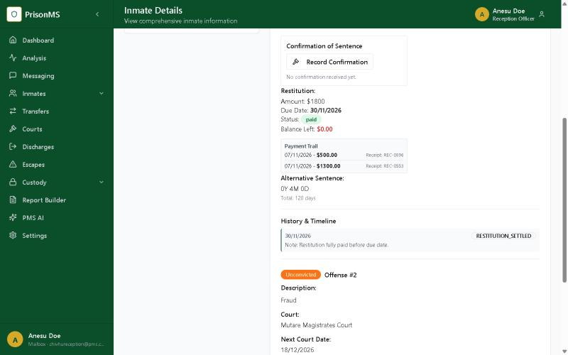
*Figure 4.7: Restitution with its due date, the payments received and the balance.*

**Restitution rules:**
- The **due date** is shown on the inmate details. If it passes unpaid, an **Overdue** badge appears.
- The restitution due date is treated as a court date: it appears on the Courts calendar.
- Payments are recorded with receipt numbers. When the balance reaches zero, the suspended part is removed and the dates are recalculated.
- If the court waives restitution, it is marked waived and the dates are recalculated the same way.

#### Scenario 6: Fine option
**Nicholas Muchengeti, 0012/26.** *Disorderly Conduct*, 60 days or a USD 50 fine.
- 60 days, remission 20, EDR **16 Dec 2026**, ODR **5 Jan 2027**.
- The fine amount is shown on the offence. If the fine is paid, Reception discharges the offence with reason **Fine paid**.

#### Scenario 7: Bail and discharge on bail
**Gift Muzondo, 0011/26.** *Criminal Nuisance*, remanded with **bail of USD 100**.
- The bail amount is shown on the offence.
- When bail is paid, Reception discharges the offence with reason **Bail**. When every offence is discharged, a discharge proposal is sent to Administration automatically (Section 10.2).

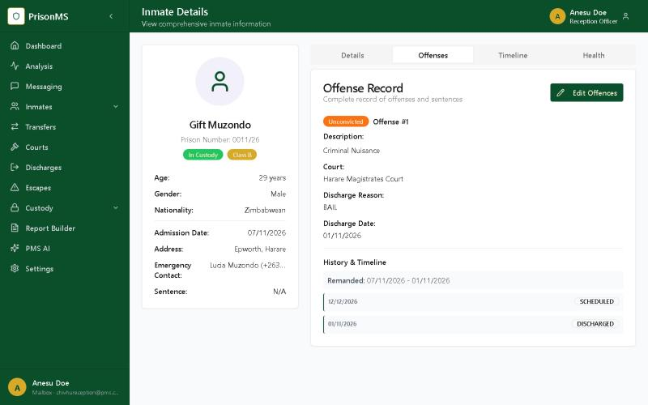
*Figure 4.8: An offence discharged on bail.*

### 4.5 Courts calendar

**Courts** lists every scheduled court session and restitution due date at the station, by day.

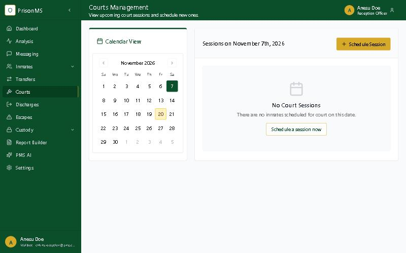
*Figure 4.9: The Courts calendar.*

### 4.6 Recording a court outcome

From the inmate details, click **Record Court Session**. The outcome can be:
- **Remanded** to a new date.
- **Convicted and sentenced**: enter the sentence, fine, restitution and concurrency, the same as at registration.
- **Discharged / acquitted / bail**: the offence is closed.

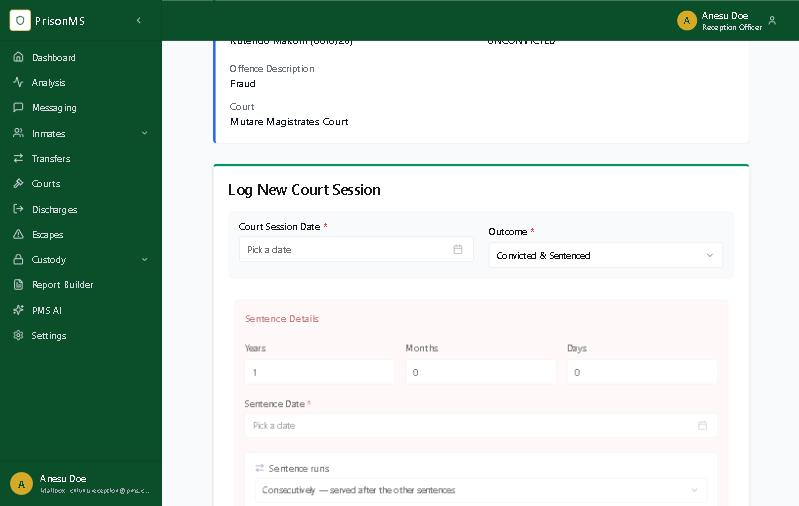
*Figure 4.10: Recording a court outcome.*

**Record Court Session is only available when there is a court matter**, that is:
- an offence is unconvicted, or
- restitution is not yet paid or waived, or
- a confirmation of sentence is awaiting court.

For a convicted inmate with nothing pending at court, the button is disabled and the reason is shown.

### 4.7 Confirmation of sentence

After conviction, the sentence may be reviewed (confirmed) by a higher court. From the offence, click **Confirmation of Sentence** and choose:

| Outcome | What happens |
|---|---|
| **Endorsed** | The sentence stands. Recorded immediately. |
| **Reduced** | A court session is scheduled. The new sentence takes effect when the outcome is recorded at that session. |
| **Increased** | Same as reduced. |

Rules:
- The **confirmation document must be uploaded** for every outcome.
- At the court session, the new sentence is entered and the **original date of sentence is kept**. Remission and release dates are recalculated from the original date with the new sentence.
- Every step is kept in the confirmation history and in the inmate timeline: who recorded it, when, the document, the old and new sentence.

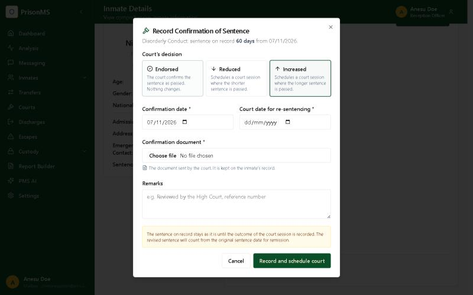
*Figure 4.11: Recording a confirmation of sentence with its document.*


*Figure 4.12: Confirmation history: 18 months reduced to 12, applied at court from the original sentence date.*

### 4.8 Discharges

An inmate leaves custody when every offence is closed (sentence served, bail, fine paid, acquitted or released by court).

1. Reception proposes the discharge from **Discharges**, giving the reason. If every offence was discharged at court, the proposal is created automatically.
2. Administration approves or rejects it (Section 10.2).
3. On approval, the inmate's status becomes **Discharged**, with the discharge date and the approving officer recorded.

After discharge:
- The inmate **leaves the Inmate List**.
- The inmate appears in the **Discharge Diary** for **five years**. Older records are archived.
- The inmate details show the banner **Discharged – Not in Custody**.

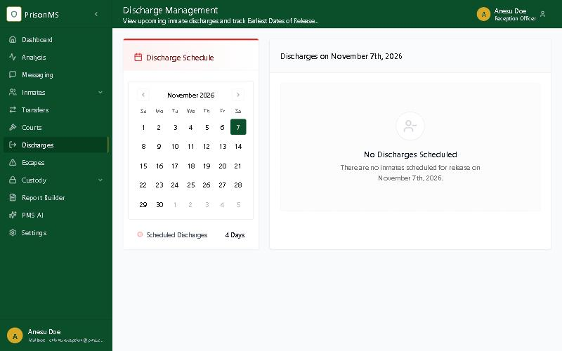
*Figure 4.13: Discharges: inmates due for release.*

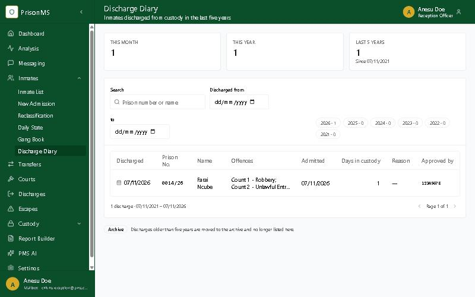
*Figure 4.14: The Discharge Diary: discharges in the last five years, with filters by date and year.*

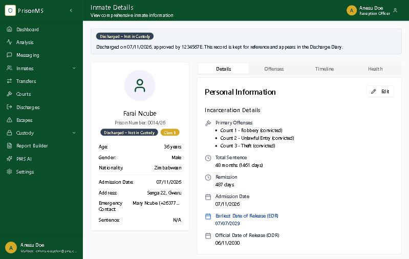
*Figure 4.15: A discharged inmate's record: "Discharged – Not in Custody".*

---

## 5. Reclassification

Inmates are classified **A, B, C or D** (Section 4.3). The class is first set at admission and approved by Administration. It is reviewed when the sentence changes (conviction, confirmation, restitution paid) or on periodic review.

**Inmates → Reclassification:**
1. Find the inmate. The screen shows the current class and the class the system calculates from the time left to serve.
2. Choose the new class and give the reason.
3. Submit. The change is recorded with the officer and date, and the inmate's history keeps every class held.

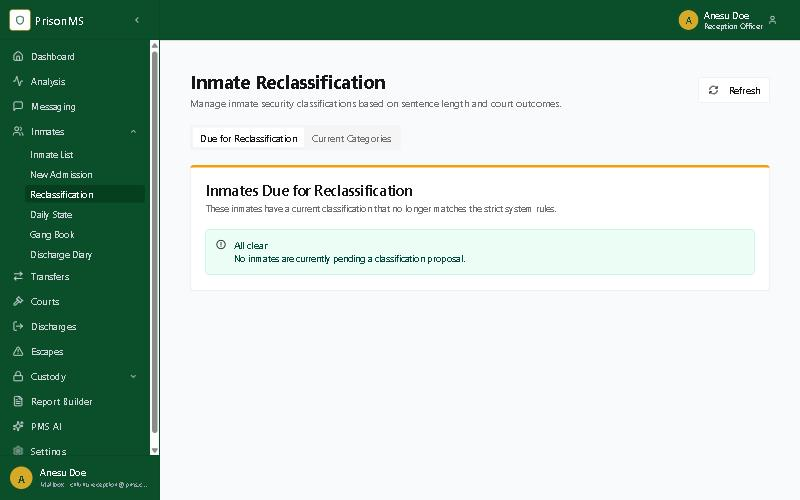
*Figure 5.1: Reclassification.*

---

## 6. Messaging

### 6.1 How each account gets an address

Messaging is internal to PMS. It cannot send to or receive from outside email. Addresses belong to **departments at a unit**, not to individual officers. Every officer in that department at that unit shares the mailbox, so work continues when staff change shifts or are posted elsewhere.

The address is created automatically when a department is added to a unit:

| Unit | Format | Example |
|---|---|---|
| Station | `{station}{department}@pms.co.zw` | `chivhureception@pms.co.zw`, `chivhuhealth@pms.co.zw` |
| Provincial HQ | `{province}{department}@pms.co.zw` | `masheastHR@pms.co.zw` |
| National HQ | `NHQ@pms.co.zw` | `NHQ@pms.co.zw` |

The officer's mailbox is shown on the account card at the bottom of the sidebar.

> The officer's own **email** (set at account creation) is a separate contact detail. It is not used by PMS messaging.

### 6.2 Sending and receiving

- **Inbox / Sent:** open **Messaging**. Unread conversations are in bold with a dot; the unread count updates on its own every few seconds.
- **Compose:** click **Compose**, enter one or more department addresses, a subject and the message, then **Send**. Several addresses can be entered, separated by commas.
- **Reply:** open a conversation and use the reply box at the bottom. Everyone in the conversation receives it.

Typical use: Reception at Chivhu writes to `chivhuhealth@pms.co.zw` to ask for an urgent assessment, or to a provincial department about a transfer.

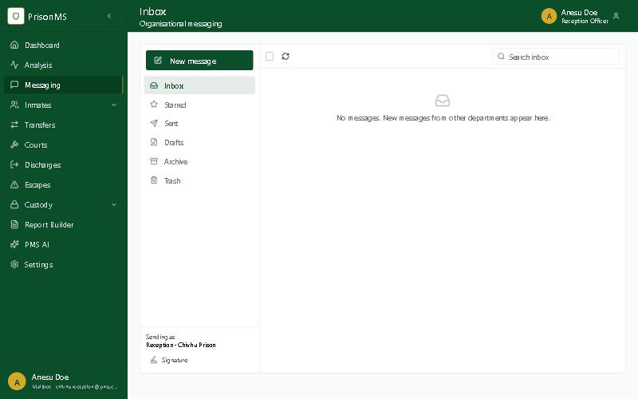
*Figure 6.1: The messaging inbox.*

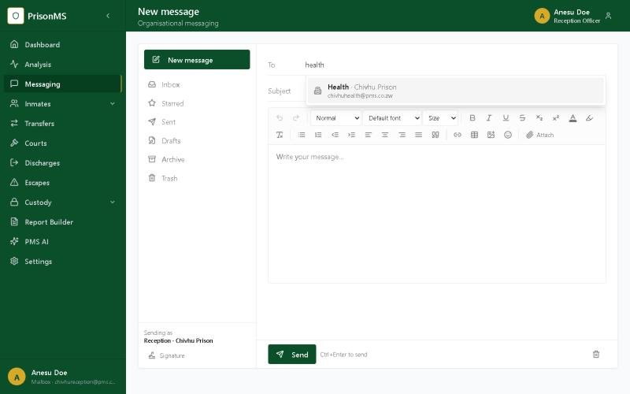
*Figure 6.2: Composing a message to a department mailbox.*

---

## 7. Report Building

**Report Builder** lets an officer build their own reports from the data their role allows.

### 7.1 What each role can report on

| Data source | Who can use it |
|---|---|
| Inmates (identity, home history, admission, classification, release dates) | Reception, Administration, Auditor |
| Offences & Sentences (court, status, sentence, remand, bail, fine, restitution) | Reception, Administration, Auditor |
| Officers | Officers with HR / user view rights |
| Patients, OPD visits, chronic patients, medicines | Health, Administration, Auditor |

Only the sources your role allows are listed, and **rows are limited to your station** (or province/country for higher units). This is enforced on the server.


*Figure 7.1: Report Builder: the sources this role may use, and saved reports.*

### 7.2 Building a report

1. Click a source under **New report**.
2. **Columns:** tick the columns to include (up to 40). Use the search box to find one.
3. **Column order:** drag a column, or use the arrows, to arrange the report from left to right.
4. **Sort rows:** up to three sort levels, ascending or descending.
5. **Filters:** add rules (e.g. *Status = Convicted*, *Sentence Date after 1 Jan 2026*) and combine them with AND/OR groups.
6. **Preview:** shows the matching rows and the total count.
7. **Export:** CSV, Excel or PDF (up to 10,000 rows).
8. **Save** the report to reuse it. Saved reports are visible to colleagues with the same role. **Save as copy** keeps the original.

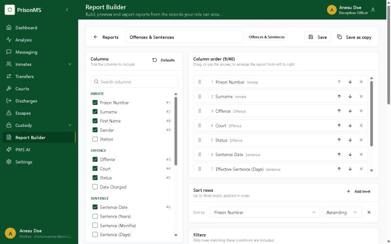
*Figure 7.2: Choosing columns (left) and arranging their order (right).*

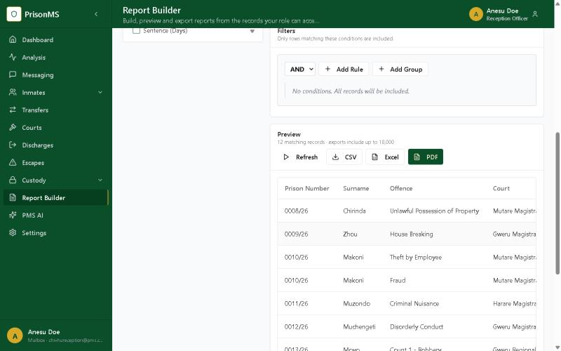
*Figure 7.3: Filters, preview and export buttons.*

---

## 8. Custody: Station Configuration, Lockup and Unlock

The custody module keeps the official count of inmates locked up each evening and unlocked each morning, cell by cell.

### 8.1 Station configuration

**Custody → Station Config.** Before counts can be taken, the station's layout must be set up:
1. **Add Yard** for each yard (e.g. *Main Yard*, *Remand Section*, *Female Section*).
2. Under each yard, **add the cells** and their capacity.
3. Yards and cells can be deactivated if they go out of use. They stay in past records.

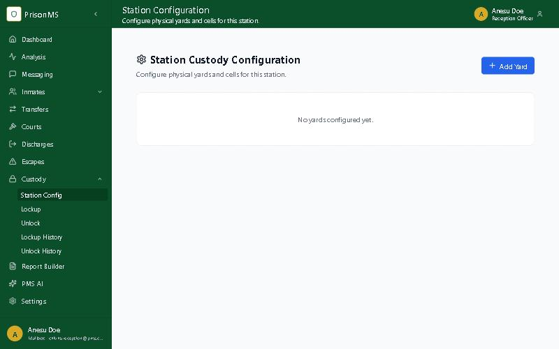
*Figure 8.1: Station configuration of yards and cells.*

If no yards are configured, Lockup and Unlock show **No Station Configuration**:

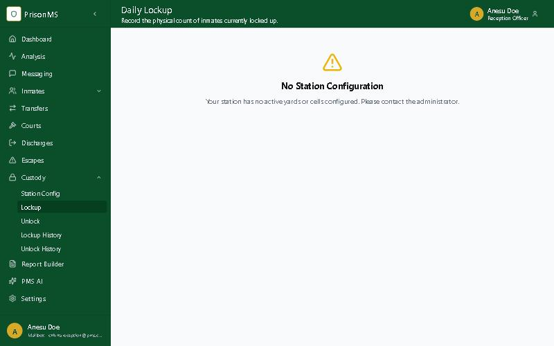
*Figure 8.2: Lockup before the station layout is configured.*

### 8.2 Lockup

**Custody → Lockup**, at evening lock-up.
1. Enter the date and time.
2. Enter the **physical count for each cell**. The system totals each yard and the whole station as you type.
3. Click **Review & Submit**. Check the totals.
4. Click **Confirm Lockup**. The record is saved with the officer who recorded it. Yard and cell names are saved with the count, so later renaming does not change history.

### 8.3 Unlock

**Custody → Unlock**, at morning unlock. The steps are the same as lockup: count per cell → **Review & Submit** → **Confirm Unlock**. Compare the unlock total with the previous lockup total; any difference must be reported and explained at once.

### 8.4 History

**Lockup History** and **Unlock History** list every count with date, total, recorder and status:

| Status | Meaning |
|---|---|
| Submitted | The count as recorded |
| Corrected | A later correction replaced it |
| Voided | Cancelled, kept for the record |

Open a record to see the count per yard and cell.

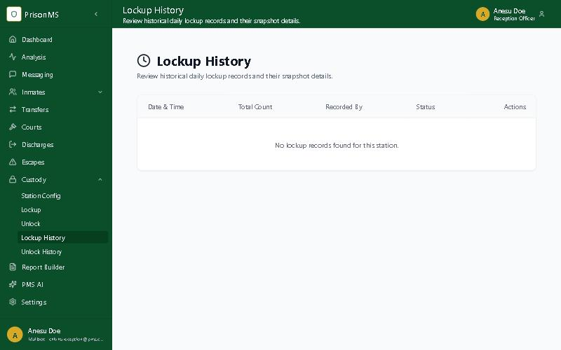
*Figure 8.3: Lockup history.*

---

## 9. Health

Health work is done by a **Health Officer** at the station.

> **Screenshots pending:** Health screens. To be captured with a Health Officer account.

### 9.1 Admission health assessment

Every newly registered inmate (status *Pending Health Assessment*) appears under **Health → Admission Assessments**.
1. Open the inmate.
2. Record weight (kg), height (cm), BMI (calculated automatically) and comments.
3. Tick **Chronic patient** if the inmate has a chronic condition; they are then added to the chronic patients register.
4. Save. The inmate moves to **Pending Admin Approval** automatically.

### 9.2 Discharge health assessment

Before an inmate leaves, **Health → Discharge Assessments**:
1. Record the weight and health status:
   - **Healthy / Fit for discharge**
   - **Requires ongoing medical care post-discharge**
   - **Critical / Unfit for standard discharge**
2. Add comments and save. Administration sees this when approving the discharge.

### 9.3 OPD (Out-Patient Department)

**Health → OPD** records every clinic visit by an inmate (and, where used, by officers, their dependants or community members).
1. Find the patient and click **New OPD visit**.
2. Record vitals: temperature, blood pressure, weight.
3. Record the problem, how long it has lasted, diagnosis, treatment and any referral.
4. Tick **Follow-up required** if needed and save.

The patient's OPD history lists every visit. Mental health visits, chronic patients, medicine stock cards and equipment have their own registers in the Health module.

---

## 10. Administration Account

The **Administration Officer** is the station's approving authority.

> **Screenshots pending:** Administration screens. To be captured with an Administration Officer account.

### 10.1 Verifying an admission

**Admin → Inmates** lists all inmates at the station with their admission status.
1. Inmates still at **Pending Health Assessment** show that they are waiting for Health. They cannot be approved yet.
2. When Health has assessed the inmate, **Approve** appears.
3. Check the registration details, the offences and sentence, the health assessment and the proposed class.
4. Click **Approve**. The admission status becomes **Admission Confirmed** and the class is confirmed (the class Reception proposed, or the class the system calculates).

### 10.2 Verifying a discharge

**Admin → Inmates → Discharges** lists discharge proposals from Reception.
1. Open the proposal. Check the inmate, the reason, the offences and the discharge health assessment.
2. **Approve** (remarks optional) or **Reject** (remarks required).
3. On approval the inmate is discharged: status, discharge date and approving officer are recorded and the inmate moves to the Discharge Diary. A rejection goes back to Reception with the remarks.

### 10.3 Other administration functions

- View every operational module at the station (Reception, Health, Stores, Security, Rehabilitation, Farms).
- Manage cases and their visibility (**Data Exposure**).
- View the station **Audit Trail**.
- Station reports.

---

## 11. Other Features

| Feature | Where | What it does |
|---|---|---|
| **Inmate List** | Inmates → Inmate List | Inmates in custody at the station, searchable by name or prison number and filterable by status and class. Discharged inmates are not listed. |
| **Inmate timeline** | Inmate details → Timeline | Every event: registration, offences, court outcomes, confirmations, payments, approvals. |
| **Analysis** | Analysis | Station statistics. |
| **Escapes** | Escapes | Escape records. |
| **Settings** | Settings | Theme (Light, Dark, System), text size (Standard, Large), password change and the officer's profile. Settings are saved on the device. |
| **Daily State, Gang Book, Transfers, PMS AI** | Sidebar | Planned. Currently show *Page Not Found*. |

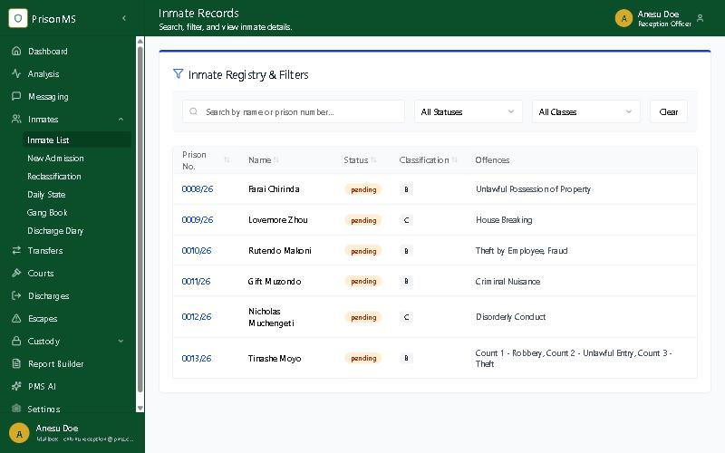
*Figure 11.1: The Inmate List.*

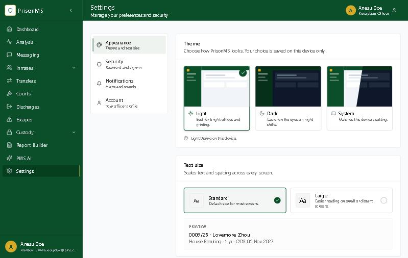
*Figure 11.2: Settings, Appearance: theme and text size with a live preview.*

---

## Appendix A: Status Reference

**Inmate status**

| Status | Meaning |
|---|---|
| Pending | Registered, admission not yet approved |
| Active / In custody | Admission approved |
| Discharged | Released; shown as *Discharged – Not in Custody* |
| Transferred | Moved to another station |

**Admission status**

| Status | Next step |
|---|---|
| Pending Health Assessment | Health officer assesses |
| Pending Admin Approval | Administration officer approves |
| Admission Confirmed | Complete |

**Confirmation of sentence**

| Status | Meaning |
|---|---|
| Completed | Endorsed; no change |
| Awaiting Court | Reduction or increase waiting for the court session |
| Applied | New sentence recorded at court from the original sentence date |

---

## Appendix B: Corrections Made While Preparing This Manual

| Issue found | Correction |
|---|---|
| A discharged offence showed the **Unconvicted** badge. | Offences now show **Convicted**, **Unconvicted** or **Discharged**, the same on every screen. |
| A court outcome could be dated before the remand began (e.g. remanded 07/11/2026, discharged 01/11/2026). | The session and sentence dates cannot be earlier than the remand start (or, for a convicted matter, the date of sentence). The date picker blocks earlier dates and the server rejects them. |
| A scheduled court session stayed **Scheduled** after its offence was discharged. | Recording an outcome answers the session scheduled for that day. Scheduled sessions it supersedes, or that are no longer needed because no court matter is left, are marked **Cancelled (No Longer Required)** and leave the Courts calendar. Existing leftovers were cancelled by the upgrade. |
| OPD temperature had to be at least 45 °C. | Temperature must be between 30 °C and 45 °C. |
| `messaging_architecture.md` described an old address format. | Updated to the live `@pms.co.zw` format. |

**Data to review:** offence records already saved with a discharge date earlier than the remand start (e.g. Gift Muzondo, 0011/26) are left as recorded. Reception should correct them from the source documents.
